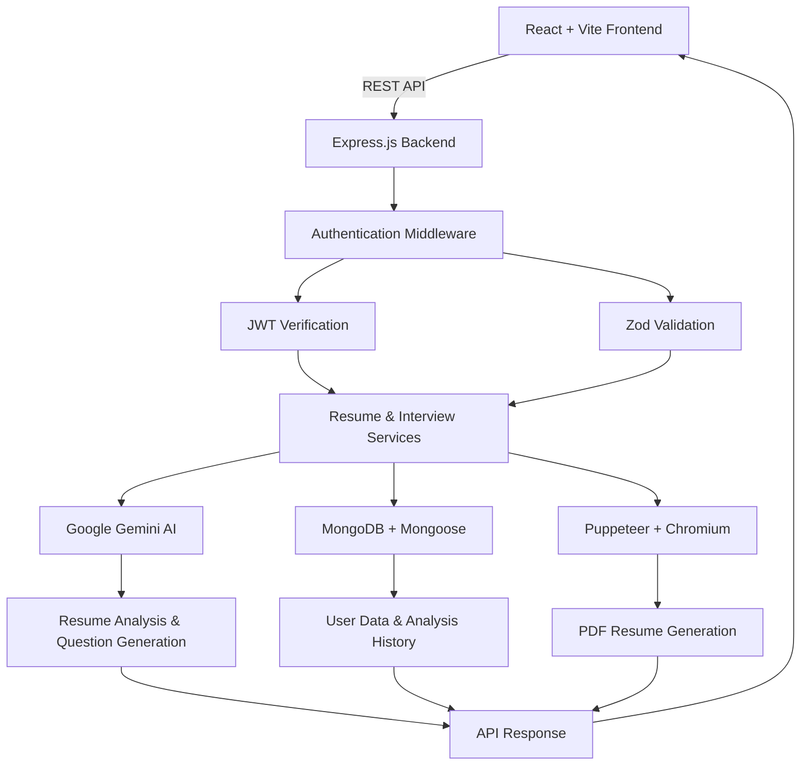

# 🚀 CareerPilot AI

### Smarter Resumes. Stronger Interviews.

**CareerPilot AI** is a full-stack, GenAI-powered career readiness platform that helps candidates optimize resumes, identify skill gaps against job descriptions, prepare for technical and behavioral interviews, and generate ATS-friendly PDF resumes.

<p align="center">
  <a href="https://interview-preparation-using-genai.vercel.app">
    
  </a>
</p>

<p align="center">
  
  
  
  
  
  
</p>

---

## 📌 Overview

Finding the right job requires more than submitting a resume. Candidates need to understand job requirements, identify missing skills, communicate their experience effectively, and prepare for role-specific interviews.

CareerPilot AI brings these activities together in one application.

By combining **React, Node.js, Express.js, MongoDB, Google Gemini AI, and Puppeteer**, the platform connects AI-powered resume analysis with personalized interview preparation and server-side PDF generation.

### 🎯 What CareerPilot AI Solves

- Understand how a resume aligns with a target job description.
- Identify relevant skills and potential gaps.
- Generate interview questions tailored to a target role.
- Get actionable insights for improving a resume.
- Export structured resumes as PDF documents.
- Access saved preparation reports through an authenticated application.

## ✨ Key Features

| Feature | Description |
|---|---|
| 🔐 Authentication | User registration, login, JWT-based authentication, and logout. |
| 📄 Resume Parsing | Extract text from supported PDF and DOCX resume formats. |
| 🎯 AI Resume Analysis | Analyze candidate experience and skills against a target job description using Google Gemini AI. |
| 📊 Skill-Gap Analysis | Identify matching skills and potential discrepancies between candidate qualifications and job requirements. |
| 🧠 Interview Preparation | Generate role-specific technical and behavioral interview questions, with hints where supported. |
| 📑 ATS-Friendly PDF Export | Generate structured PDF resumes through Puppeteer and headless Chromium. |
| 🗂️ Analysis History | Retrieve previously generated resume and interview preparation reports. |
| 🛡️ Request Validation | Validate incoming data and structured AI responses using Zod. |
| 🔄 Frontend State Management | Manage shared application state using React Context and custom hooks. |

## 🏗️ System Architecture

CareerPilot AI follows a client-server architecture that separates the frontend, REST API, authentication, AI processing, data persistence, and PDF rendering.



### Application Workflow

1. **Input:** The candidate uploads a resume and provides a target job description.
2. **Validation:** The backend validates the request and processes the uploaded file.
3. **Parsing:** Resume content is extracted into machine-readable text.
4. **AI analysis:** Google Gemini analyzes the candidate profile against the job requirements.
5. **Structured response:** Generated results are validated before being used by the application.
6. **Persistence:** Relevant reports are saved for future access, where supported.
7. **Export:** The candidate can generate a formatted PDF resume through the server-side rendering pipeline.

## 🧰 Technology Stack

### Frontend

- **React 18** — Component-based user interface.
- **Vite** — Development server and frontend build tooling.
- **React Router v6** — Client-side navigation and route protection.
- **React Context API** — Shared authentication and application state.
- **Custom React Hooks** — Reusable application logic.
- **Axios** — HTTP requests and centralized API handling.

### Backend

- **Node.js** — Server-side JavaScript runtime.
- **Express.js** — REST API and middleware architecture.
- **MongoDB Atlas** — Persistent document storage.
- **Mongoose** — Database schemas and model operations.
- **JWT** — Token-based authentication.
- **Zod** — Runtime schema validation.
- **Multer** — Multipart file-upload processing.

### Generative AI & Document Processing

- **Google Gemini API** — Contextual resume analysis and interview-question generation.
- **Prompt Engineering** — Task-specific prompts for consistent, structured AI responses.
- **Puppeteer** — Automated browser-based PDF rendering.
- **Headless Chromium** — HTML and CSS document rendering.
- **PDF/DOCX Parsing Libraries** — Resume text extraction for supported document formats.

## 💡 Engineering Highlights

### 1. Structured AI Output Validation

Large language models can return unexpected or malformed responses. CareerPilot AI uses structured prompting and Zod validation to establish a validation boundary around generated data.

**Engineering benefits:**
- Validate data before downstream processing.
- Handle malformed responses more predictably.
- Reduce runtime failures caused by unexpected data shapes.
- Keep AI service logic separate from application logic.

### 2. JWT Authentication & Session Revocation

JWT authentication requires additional handling when a user logs out before the token expires. A token-revocation mechanism can maintain a record of invalidated tokens until their expiration.

**Engineering benefits:**
- Explicit session lifecycle management.
- Protected API routes.
- A mechanism for rejecting revoked tokens.

*Implementation detail: document the actual blacklist storage mechanism used by the application, such as MongoDB or Redis.*

### 3. Server-Side PDF Generation

CareerPilot AI uses Puppeteer to render HTML and CSS through a headless browser for PDF generation.

Compared with rasterized, canvas-based exports, HTML-based rendering can preserve selectable text and document structure more effectively.

**Engineering benefits:**
- Consistent browser-based document rendering.
- Control over page layout, fonts, and print styles.
- Text-based PDF output that can be evaluated with ATS parsing tools.

*Note: ATS compatibility depends on the generated document's structure and the parser used by the employer.*

### 4. Modular Full-Stack Architecture

The application separates API routes, controllers, middleware, database models, validation schemas, and business services.

**Engineering benefits:**
- Separation of concerns.
- Improved maintainability.
- Easier debugging and testing.
- Clearer boundaries between AI processing and application logic.

### 5. Resume File Processing

Resume uploads require careful handling because files originate from external users. Backend upload middleware provides a place to validate and process supported file formats.

**Engineering considerations:**
- File-type and file-size restrictions.
- Validation before parsing.
- Error handling for malformed or unsupported documents.
- Protection of sensitive candidate information.

## 📂 Project Structure

The following structure illustrates the intended organization. Adjust it to match your actual repository.

```text
careerpilot-ai/
├── client/
│   ├── src/
│   │   ├── components/       # Reusable UI components
│   │   ├── context/          # Shared application state
│   │   ├── hooks/            # Custom React hooks
│   │   ├── pages/            # Application pages
│   │   ├── services/         # API clients and interceptors
│   │   └── utils/            # Utility functions
│   ├── .env.example
│   └── vite.config.js
│
├── server/
│   ├── src/
│   │   ├── config/           # Database and AI configuration
│   │   ├── controllers/      # Request handlers
│   │   ├── middlewares/      # Authentication and uploads
│   │   ├── models/           # Mongoose models
│   │   ├── routes/           # REST API routes
│   │   ├── services/         # AI and PDF processing
│   │   └── validators/       # Zod schemas
│   ├── .env.example
│   └── server.js
│
├── .gitignore
└── README.md
```

## ⚙️ Getting Started

Follow these instructions to run CareerPilot AI locally.

### Prerequisites

- Node.js compatible with the project's dependencies.
- npm.
- MongoDB Atlas or a local MongoDB instance.
- A Google Gemini API key.
- A compatible Puppeteer/Chromium runtime for PDF generation.

### 1. Clone the Repository

```bash
git clone https://github.com/YOUR_USERNAME/careerpilot-ai.git
cd careerpilot-ai
```

Replace `YOUR_USERNAME/careerpilot-ai` with your actual GitHub repository URL if it differs.

### 2. Set Up the Backend

```bash
cd server
npm install
```

Create a `.env` file inside the `server` directory:

```env
PORT=5000
MONGODB_URI=your_mongodb_connection_string
JWT_SECRET=your_secure_random_secret
GEMINI_API_KEY=your_gemini_api_key
CLIENT_URL=http://localhost:5173
```

Start the backend using the development script defined in `server/package.json`. If the project has a `dev` script, run:

```bash
npm run dev
```

### 3. Set Up the Frontend

Open another terminal from the repository root:

```bash
cd client
npm install
```

Create a `.env` file inside the `client` directory:

```env
VITE_API_BASE_URL=http://localhost:5000/api
```

Start the frontend:

```bash
npm run dev
```

### 4. Open the Application

Visit:

**http://localhost:5173**

Make sure the backend, database, and required environment variables are configured.

> **Security:** Never commit API keys, database credentials, JWT secrets, or `.env` files to GitHub. Add environment files to `.gitignore` and provide sanitized `.env.example` files.

## 📡 REST API Reference

The following endpoints represent the intended API surface. Verify the actual routes, HTTP methods, and access controls against your backend before publishing.

| Method | Endpoint | Description | Access |
|---|---|---|---|
| `POST` | `/api/auth/register` | Register a new user | Public |
| `POST` | `/api/auth/login` | Authenticate a user | Public |
| `POST` | `/api/auth/logout` | Invalidate the active session | Private |
| `POST` | `/api/resume/analyze` | Parse and analyze a resume against a job description | Private |
| `GET` | `/api/resume/reports` | Retrieve saved preparation reports | Private |
| `POST` | `/api/resume/export-pdf` | Generate a PDF resume | Private |

**Local API base URL:** `http://localhost:5000/api`

## 🔒 Security Considerations

CareerPilot AI handles authentication data and potentially sensitive candidate documents. Important security considerations include:

- Keep AI API keys and other secrets on the backend.
- Validate incoming request payloads before processing.
- Enforce authentication and authorization on protected endpoints.
- Restrict upload size and supported file types.
- Avoid logging sensitive resume content or credentials.
- Validate AI-generated data before storing or returning it.
- Configure CORS, cookie attributes, and token expiration appropriately.
- Apply rate limiting and other abuse-prevention controls where needed.

## 🚀 Future Improvements

Potential enhancements for future versions:

- [ ] Add automated frontend and backend tests.
- [ ] Add regression tests for AI-generated outputs.
- [ ] Improve error handling and AI request observability.
- [ ] Add API rate limiting and upload abuse protection.
- [ ] Compare resume-analysis results across multiple job descriptions.
- [ ] Add CI/CD checks and deployment automation.
- [ ] Include a product walkthrough and application screenshots.

## 👨‍💻 About

CareerPilot AI demonstrates the integration of full-stack web development with practical generative AI capabilities.

The project brings together frontend development, REST API design, database persistence, authentication, LLM-powered analysis, file processing, and server-side PDF generation to address a real-world career-readiness problem.

### 🔗 Project Links

- **Live Demo:** [CareerPilot AI](https://interview-preparation-using-genai.vercel.app)
- **GitHub Repository:** Add your actual repository URL here
- **Developer:** Yashpal Rajpurohit

---

<p align="center">
  <strong>CareerPilot AI</strong><br/>
  Smarter Resumes. Stronger Interviews.
</p>

<p align="center">
  Built with React, Node.js, MongoDB, and Google Gemini AI.
</p>
